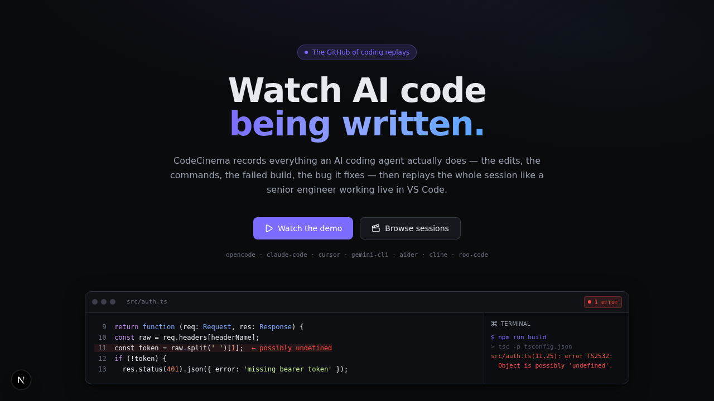
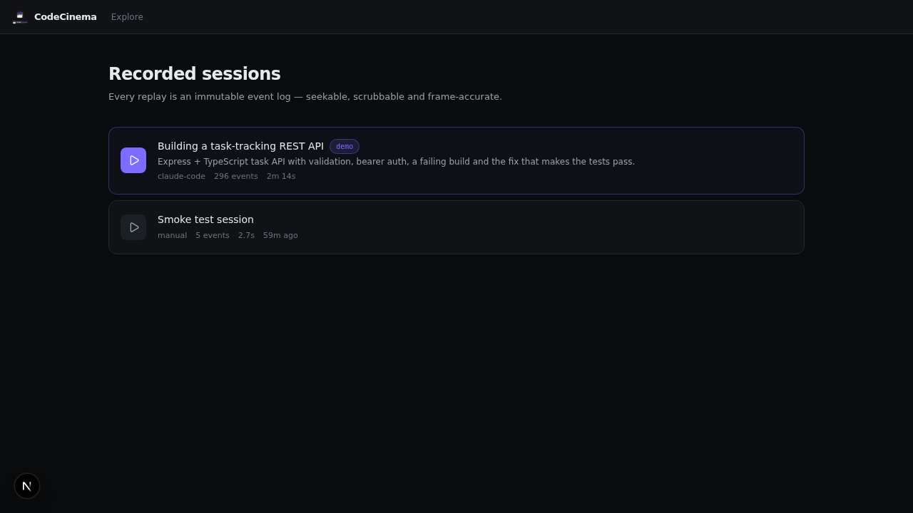
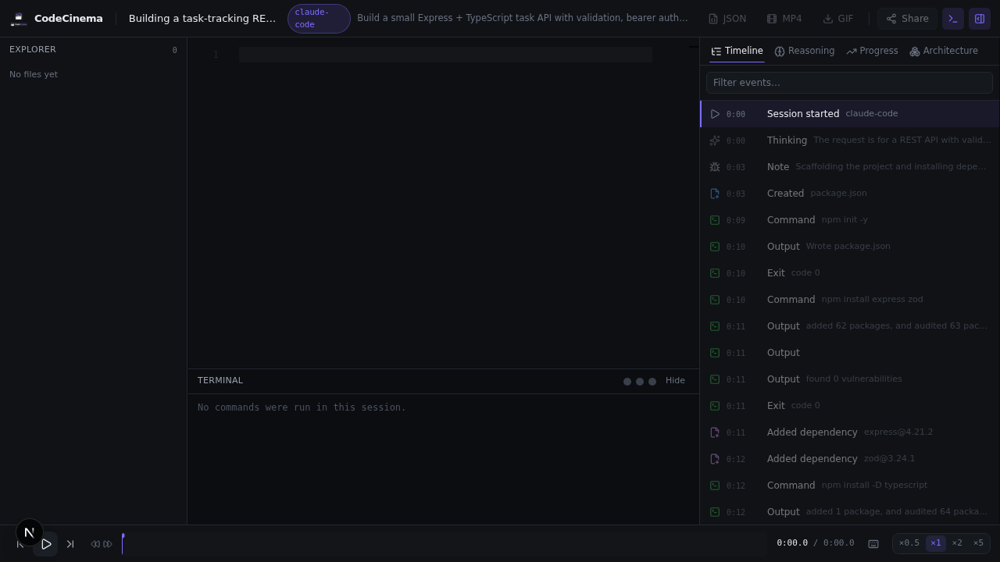

# CodeCinema

**Watch AI code being written.**

CodeCinema records how AI coding agents actually work — every keystroke, every
command, the failing build, the error the agent read, the line it rewrote —
and replays the whole session like a senior engineer working live in VS Code.

It is not a screen recording. The session is stored as an **append-only event
log** and reconstructed in the browser, so a replay is frame-accurate,
scrubbable, searchable, and portable between agents.

```
  agent ──▶ adapter ──▶ canonical events ──▶ append-only log ──▶ 60fps replay
             ▲                                    │
             └── repo watcher + shell ───────────┘
```

---

## See it in action


| Home | Explore | Replay |
| --- | --- | --- |
|  |  |  |

A short video walkthrough is also available: [demo.mp4](docs/media/demo.mp4).

## What it does

**Records the agent's actual changes.** Not just the final code — the create,
the edit, the deletion, the mistake, the fix, the rebuild. A recorder watches
the working tree and the shell, so it works with *any* agent, including ones
we have never heard of.

**Replays like a human.** Character-by-character typing at human speed, micro-
pauses on punctuation, a deliberate beat before each function body, cursor
movement, selection highlights, backspaces, rewrites, tab switches and scroll.

**Explains itself.** Educational mode puts the reasoning beside the code:
*"Adding validation"*, *"Handling exceptions"*, *"Writing unit tests"*.

**Recovers the architecture.** Import graphs, module map and dependency list,
extracted from the finished code.

**Exports.** JSON session, MP4 video, GIF, and shareable replay links.

## Supported agents

| Agent | Source of truth | Status |
| --- | --- | --- |
| OpenCode | server event stream | adapter + recorder |
| Claude Code | `--output-format stream-json` | adapter + recorder |
| Cursor | `cursor-agent --output-format stream-json` | adapter + recorder |
| Gemini CLI | `--output-format stream-json` | adapter + recorder |
| Aider | chat history + applied diff | adapter + recorder |
| Cline | VS Code `globalStorage` task history | adapter |
| Roo Code | VS Code `globalStorage` task history | adapter |

Every agent also works through the **generic recorder**, which needs no agent
support at all.

## Quick start

```bash
git clone https://github.com/you/codecinema.git
cd codecinema
docker compose up --build
```

| Service | URL |
| --- | --- |
| Web app | http://localhost:3000 |
| API + OpenAPI | http://localhost:8000/docs |
| Postgres | `localhost:5432` |
| Redis | `localhost:6379` |

Then open **http://localhost:3000/demo** for a fully self-contained replay —
a bundled session where the agent hits a type error, reads it, fixes it and
gets the tests green.

### Run it locally without Docker

```bash
# API
cd backend
python -m venv .venv && source .venv/bin/activate
pip install -e ".[dev]"
uvicorn app.main:app --reload

# Web
cd frontend
npm install
npm run dev
```

### Record a session

```bash
# Wrap any agent — the recorder watches the repo and the shell
cd backend
python -m app.recorder.cli record \
  --repo ~/projects/my-app \
  --agent claude-code \
  --output session.ndjson \
  -- claude -p "add a health endpoint and tests"
```

The NDJSON file is the canonical event stream. Push it to the API with
`POST /v1/ingest/{agent}`.

## Architecture at a glance

```
frontend/                     Next.js 16 · React 19 · TypeScript · Tailwind 4
  lib/engine/                 the playback engine (framework-agnostic)
    events.ts                 canonical event model
    pieceTable.ts             rope data structure for replayed text
    humanize.ts               deterministic human-like typing simulation
    state.ts                  pure reducer (fold events → state)
    engine.ts                 clock, checkpoints, seeking, two view channels
  components/player/          Monaco editor, terminal, explorer, timeline…
backend/                      FastAPI · SQLAlchemy 2 (async) · Alembic · Redis
  app/adapters/               7 agent adapters + the generic recorder
  app/recorder/               repo watcher, command capture, session recorder
  app/export/                 Playwright + ffmpeg render pipeline
shared/                       the cross-language contract
  schemas/event.schema.json   the event JSON Schema
  fixtures/                   golden session used by both test suites
docs/                         architecture, event model, API, adapters, deploy
```

Read next:

* [Architecture](docs/architecture.md) — why it is shaped this way
* [Event model](docs/event-model.md) — the contract, action by action
* [API reference](docs/api.md) — every endpoint
* [Adapters](docs/adapters.md) — how each agent is translated
* [Deployment](docs/deployment.md) — production setup

## Design notes

**Event sourcing is not a buzzword here.** It is the reason the product
works. Scrubbing is "replay the log up to `t`". Sharing is "share a log".
Re-rendering with different timing is "replay the same log differently".
Debugging a bad replay is "read the log".

**Determinism.** Typing simulation uses a seeded PRNG derived from the session
id, file path and event index. Two viewers at the same millisecond see the
same pixels, and a reload reproduces the session exactly.

**Two view channels.** The engine publishes structural changes (files, tabs,
timeline) separately from per-frame changes (visible text, terminal output).
Without that split, a 60fps typing animation would re-render the whole UI 60
times a second.

**Text is a rope.** Replaying 100 000 edits against a plain JS string is
O(n²). The piece table makes an edit O(log n) and pays the flattening cost
only when the text is read.

**Adapters are tolerant.** Agent output formats change between releases. An
unknown event shape is skipped, never fatal — a parser that crashes on a new
field would take out the whole ingest path.

## Performance

| Requirement | How |
| --- | --- |
| 60 fps | Imperative Monaco updates; display channel bypasses React. |
| 100k+ events | Piece table, checkpointed seeks, windowed timeline, canvas scrubber. |
| Playback state recovery | Position persisted per session and mirrored in the URL hash (`#t=12345`). |
| Event sourcing | Append-only `session_events`; every view is a projection. |
| Modular plugins | `AgentAdapter` interface, export format registry, event-type extension point. |

## Testing

```bash
cd frontend && npm run test     # 37 unit tests: engine, piece table, humanizer
cd backend  && pytest -q        # adapters, reducer, API, recorder
```

Both suites validate the **same** golden fixture in `shared/fixtures/`, so the
TypeScript and Python reducers cannot drift.

## Contributing

See [docs/contributing.md](docs/contributing.md). The short version: the
event schema is the contract; change it in `shared/schemas/event.schema.json`,
mirror it in TypeScript and Python, and CI will tell you if you missed a spot.

## Licence

MIT.
